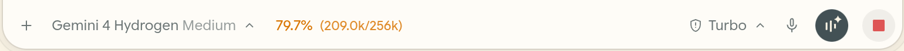
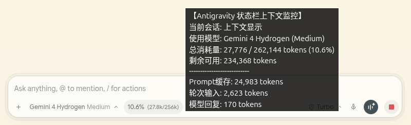

# Antigravity Context Lite

English | [简体中文](README.zh-CN.md)

An ultra-lightweight real-time Context Window monitor built for Antigravity IDE, with zero external runtime dependencies.

### Inline Toolbar


### Hover Details


## Key Features
- **Native Inline Embedding (CDP Mode)**: Seamlessly mounts inside the chat composer footer right next to the model selector (`.agy-composer-footer`) with a transparent background and no border; automatically falls back to a floating bottom-right pill when the composer is unavailable.
- **Dynamic Model & Context Limit Resolution**: Queries the local `language_server` `GetUserStatus` endpoint on startup (and refreshes on unknown models) to resolve display names and infer context limits (`256k` default compaction threshold for Gemini, `200k` for Claude models, `128k` for GPT-OSS / 128k, `2M` for 2M models) without manual config updates.
- **Three-Tier Color Warnings & Tooltip Breakdown**: Uses native muted/emerald under `50%`, amber between `50%` and `80%`, and red at `≥ 80%`. Hovering reveals Prompt Cache, turn input, model output, and incremental token estimates.
- **Cross-Platform**: Unified support for Linux, Windows, and macOS (reads `DevToolsActivePort` automatically, with local listening-port scanning fallback on Windows).

## Project Structure
```text
antigravity-context-lite/
├── docs/
│   ├── preview-inline.png        # Inline toolbar preview
│   └── preview-hover.png         # Hover tooltip preview
├── src/
│   └── extension.ts              # VS Code extension source (status bar mode)
├── scripts/
│   ├── cdp-helpers.mjs           # Cross-platform process/CSRF/CDP target discovery
│   ├── inject-statusbar.mjs      # Live CDP injector (inline composer + fallback)
│   └── statusbar-daemon.mjs      # Background daemon (polls every 6s and re-injects)
├── LICENSE                       # MIT License
├── package.json
└── tsconfig.json
```

## Usage

### Option 1: Live CDP Inline Injection (Recommended)
Requirements: Node.js `>= 20` (built-in `fetch` and `WebSocket`) and an active Antigravity `DevToolsActivePort`.

One-shot injection test:
```bash
node scripts/inject-statusbar.mjs
```

Background auto-injection daemon:
```bash
node scripts/statusbar-daemon.mjs
```

- **Linux (`systemd`)**: Create a service running `node /path/to/antigravity-context-lite/scripts/statusbar-daemon.mjs`.
- **Windows (hidden startup)**: Place a `.vbs` script in `shell:startup`:
  ```vbscript
  CreateObject("Wscript.Shell").Run "node ""C:\path\to\antigravity-context-lite\scripts\statusbar-daemon.mjs""", 0, False
  ```

### Option 2: VS Code / VSIX Extension (Native Status Bar)
```bash
npm install
npm run compile
npm run package
```
In Antigravity IDE / VS Code, run `Extensions: Install from VSIX...` and select the generated `.vsix` file.

## Compatibility & Disclaimer
- This project reads `--csrf_token` from the local `language_server` process arguments to call local RPC endpoints (`GetUserStatus`, `GetAllCascadeTrajectories`, `GetCascadeTrajectorySteps`). CDP mode also relies on Antigravity frontend DOM selectors (such as `.agy-composer-footer`).
- These internal interfaces and DOM selectors are not official public APIs and may require adjustments across Antigravity IDE updates.

## License
[MIT](LICENSE)
