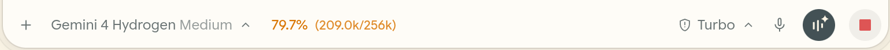
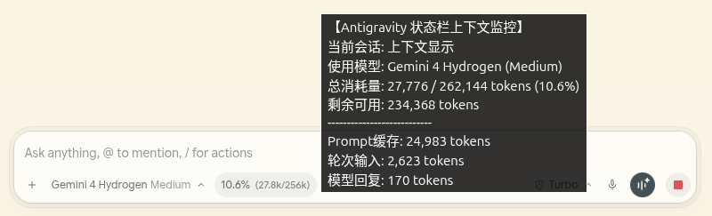

# Antigravity Context Lite

[English](README.md) | 简体中文

专为 Antigravity IDE 打造的超轻量上下文窗口（Context Window）实时监控工具，零外部生产依赖。

> **模式选择说明：**
> - **Antigravity 2.x 独立桌面端**：请使用 **方式 1（CDP 模式，`scripts/`）**。2.x 不支持 `.vsix` 扩展，且默认会自动生成 `DevToolsActivePort`。
> - **Antigravity 1.x（VS Code 内核）/ VS Code**：可使用 **方式 2（`.vsix` 扩展）**。

### 内联效果预览


### 悬停详情预览


## 核心特性
- **原生工具栏内联嵌入（CDP 模式）**：优先无感嵌入聊天输入框底部模型选择器右侧（`.agy-composer-footer`），透明背景无边框；未检测到输入框时自动回退至右下角悬浮胶囊。
- **动态模型与上限识别**：启动后自动从本地 `language_server` 的 `GetUserStatus` 接口拉取最新模型显示名，并按规则判定上下文上限（Gemini 默认 `256k` 压缩线、Claude 系列 `200k`、`GPT-OSS / 128k` 为 `128k`、`2M` 为 `2M`），新模型上线免改配置。
- **三级色彩预警与详情 Tooltip**：`< 50%` 沿用原生灰/翠绿，`50% ~ 80%` 转琥珀黄，`≥ 80%` 转红；悬停可查看 Prompt 缓存、轮次输入、模型回复及增量估算明细。
- **跨平台支持**：统一支持 Linux / Windows / macOS（自动读取 `DevToolsActivePort`，Windows 支持本地监听端口扫描兜底）。

## 项目结构
```text
antigravity-context-lite/
├── docs/
│   ├── preview-inline.png        # 内联效果预览
│   └── preview-hover.png         # 悬停详情预览
├── src/
│   └── extension.ts              # VS Code 扩展源码（右下角状态栏模式）
├── scripts/
│   ├── cdp-helpers.mjs           # 跨平台进程/CSRF/CDP 目标发现共享模块
│   ├── inject-statusbar.mjs      # CDP 现场热注入脚本（支持输入框内联嵌入）
│   └── statusbar-daemon.mjs      # 常驻守护进程（每 6s 巡检并在刷新后自动重注）
├── LICENSE                       # MIT License
├── package.json
└── tsconfig.json
```

## 使用方式

### 方式 1：CDP 实时内联注入（Antigravity 2.x 必选，推荐）
前置要求：Node.js `>= 20`（内置 `fetch` 与 `WebSocket`），且 Antigravity 2.x 正在运行（默认会自动生成 `DevToolsActivePort`）。可直接克隆仓库，或从 [Releases](https://github.com/totoro-atelier/antigravity-context-lite/releases) 下载 `antigravity-context-lite-cdp-v1.0.0.zip` 解压使用。

单次注入测试：
```bash
node scripts/inject-statusbar.mjs
```

后台常驻自动注入：
```bash
node scripts/statusbar-daemon.mjs
```

- **Linux 开机/常驻建议**：配置 `systemd` 服务运行 `node /path/to/antigravity-context-lite/scripts/statusbar-daemon.mjs`。
- **Windows 无窗口常驻**：创建 `.vbs` 启动脚本放入 `shell:startup`：
  ```vbscript
  CreateObject("Wscript.Shell").Run "node ""C:\path\to\antigravity-context-lite\scripts\statusbar-daemon.mjs""", 0, False
  ```

### 方式 2：VS Code / VSIX 扩展（右下角原生状态栏）
```bash
npm install
npm run compile
npm run package
```
在 Antigravity IDE / VS Code 中执行 `Extensions: Install from VSIX...` 选择生成的 `.vsix` 安装（或直接从 [Releases](https://github.com/totoro-atelier/antigravity-context-lite/releases) 下载预编译的 `.vsix`）。

## CDP 模式 vs VSIX 扩展对比
| 特性 | CDP 内联模式（`scripts/`） | VSIX 扩展（`antigravity-context-lite.vsix`） |
|---|---|---|
| 显示位置 | 直接嵌入聊天输入框工具栏（`.agy-composer-footer`），无输入框时回退右下角悬浮 | 原生 VS Code 底部右侧状态栏 |
| 悬停详情 | 展示 Prompt 缓存、轮次输入、模型回复等完整明细 | 同等完整明细 |
| 部署方式 | Node.js `>= 20` 直接运行，无需安装扩展 | 通过 `Install from VSIX...` 安装 |

## 已验证环境
- **操作系统**：Ubuntu 24.04 LTS、Windows 11
- **IDE 版本**：Antigravity IDE `2.31.2`
- **运行环境**：Node.js `>= 20`（已验证 Node.js `24.x`）

## 常见排查
- **提示找不到 `DevToolsActivePort`**：确认 Antigravity 正在运行且已生成 `DevToolsActivePort`（Linux 位于 `~/.config/Antigravity/`，Windows 位于 `%APPDATA%\Antigravity\`，macOS 位于 `~/Library/Application Support/Antigravity/`）。
- **状态栏未出现**：确认 `node -v` 为 `20` 及以上（依赖内置 `fetch` 与 `WebSocket`），并手动执行一次 `node scripts/inject-statusbar.mjs` 查看终端输出。

## 兼容与免责声明
- 本项目通过读取本机 `language_server` 进程参数中的 `--csrf_token` 调用本地 RPC（`GetUserStatus`、`GetAllCascadeTrajectories`、`GetCascadeTrajectorySteps`），CDP 模式同时依赖 Antigravity 前端 DOM 结构（如 `.agy-composer-footer`）。
- 上述内部接口与 DOM 选择器非官方公开 API，随 Antigravity IDE 版本迭代可能需要微调适配。

## License
[MIT](LICENSE)
